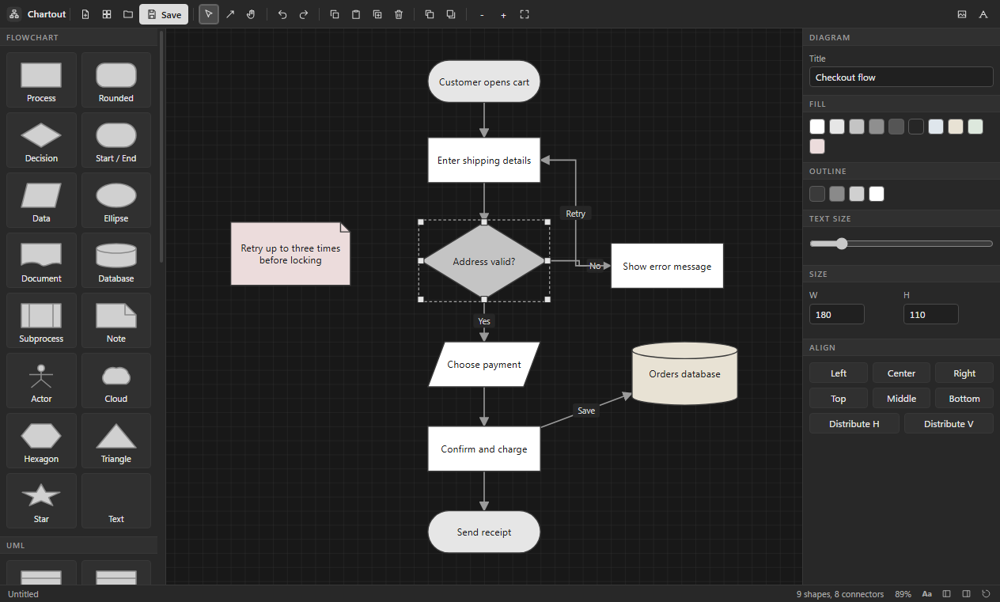
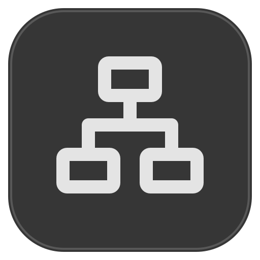

<h1 align="center">Chartout</h1>

<b>Flowcharts and diagrams</b> Version 1.0.17 for Windows · Free · Offline · No account

<a href="https://github.com/plawanpawin-byte/chartout/releases/latest"><b>Download Chartout</b></a> · <a href="https://github.com/plawanpawin-byte/lookout-launcher">Lookout launcher</a> · <a href="https://github.com/plawanpawin-byte/Lookout">All Lookout apps</a>

---

Chartout is a diagram maker for flowcharts, org charts, process maps and quick sketches of how things connect. Drag shapes onto an unlimited canvas, join them with connectors that follow the shapes around, then export a clean PNG or SVG.

**Made for:** Anyone explaining a process or a structure: teams documenting workflows, students drawing algorithms, managers mapping reporting lines.

**On this page:** [In plain words](#in-plain-words) · [Who it is for](#who-it-is-for) · [Try it in 3 steps](#try-it-in-3-steps) · [Screenshots](#see-it-in-action) · [Features](#everything-it-can-do) · [How to use it](#how-to-use-it) · [Privacy](#private-by-design) · [Install](#install) · [Questions](#questions)

## In plain words

Chartout is a drawing program for **diagrams that show how things connect**: a flowchart of how an order is handled, an organisation chart, a process map, the steps of a recipe, or a quick sketch of how a system works. You drag shapes (boxes, diamonds, circles) from the left panel onto a big blank canvas, type text in them, and join them with arrows.

The arrows are **connectors**: they stay attached to the shapes. If you move a box, the arrow follows it, so you can rearrange a diagram without redrawing anything. When you are happy, export it as a PNG picture or an SVG drawing and paste it into a document or slide.

**Not for:** Chartout is for diagrams made of boxes and arrows. It is not a chart maker for numbers (bar or pie charts) and not a full vector illustration program.

## Who it is for

- **Teams** documenting how work flows from one step to the next.
- **Students** drawing algorithms, decision trees or family trees.
- **Managers** who need a clean org chart for a presentation.

## Try it in 3 steps

1. Drag a **Process** shape onto the canvas and double-click it to type.
2. Join two shapes with a connector (the How to use it steps below show how). It stays attached when you move them.
3. Select several shapes and use the align and distribute buttons to line them up neatly. Then export a PNG.

## What is new in 1.0.18 (beta)

[Download the 1.0.18 beta](https://github.com/plawanpawin-byte/chartout/releases/tag/v1.0.18). The screenshots below still show the older layout.

- A new Google-style layout: the diagram name in the top bar, a Shapes panel with categories and search, floating toolbars, and a keyboard shortcuts window.
- Closing the window with unsaved changes now asks first. Before, the window could not be closed at all.
- New, Open and Templates ask only when there are unsaved changes.
- Saving writes a temporary file first, and read-only or locked files give a plain message.
- Many fixes to undo and redo, Thai text wrapping, connector labels, export, damaged files and keyboard shortcuts (also with a Thai keyboard layout).
- Not changed yet: Save asks for a location every time.

## See it in action

### A flowchart on the canvas

Shapes on an unlimited canvas with labelled connectors. The decision diamond branches into Yes and No, and a retry arrow loops back.

### Shape properties

Select a shape to change its fill, outline, text and size in the panel on the right.

### Select, align and distribute

Select several shapes and tidy them with the align and distribute buttons so rows and columns line up exactly.

### Exported PNG

The same chart exported as a high-resolution image with a clean white background.

### Another result: an org chart

Elbow connectors route neatly from parent to child, which makes organisation charts quick to build.

## The interface

- **Top bar:** file buttons, the Select, Connector and Hand tools, edit and arrange actions, zoom, and Export PNG / SVG.
- **Left panel:** the shape library as large previews, plus canvas options such as the grid and snapping.
- **Right panel:** the diagram title, or the fill, outline, text size, size and align controls of whatever is selected.

## Everything it can do

### Shapes

- Process, rounded, decision, data, ellipse, document, database, subprocess, note, actor, cloud, hexagon, triangle, star and free text
- Change fill colour, outline, text and size in the properties panel
- Bring a shape to the front or send it back

### Connectors

- Connect any two shapes; the line follows when you move them
- Straight or elbow (right-angle) routing
- Optional arrowheads, dashed lines and text labels on every connector

### Arranging

- Select several shapes with a drag box or Shift + click
- Align and distribute horizontally or vertically
- Copy, paste and duplicate

### Canvas

- Unlimited canvas with pan, zoom and Fit
- Hand tool, or hold Space and drag to pan
- Undo and redo

### Files and export

- Save and reopen your diagrams as .chartout files
- Export PNG for documents and slides
- Export SVG for sharp scaling and further editing

## How to use it

1. Pick a shape from the left to place it on the canvas.
2. Double-click a shape and type its text.
3. Choose **Connector**, then click one shape and another to join them. Use **Edit label** to name a branch such as Yes or No.
4. Select several shapes and use the align and distribute buttons to straighten them.
5. Press **Export PNG** or **Export SVG**.

## Keyboard shortcuts

| Keys | What it does |
| --- | --- |
| Double-click | Edit a shape's text |
| Space + drag | Pan the canvas |
| Ctrl + mouse wheel | Zoom |
| Ctrl + A / C / V / D | Select all, copy, paste, duplicate |
| Ctrl + S | Save |
| Ctrl + Z / Y | Undo / redo |
| Delete | Remove the selection |

## Files and formats

Saves .chartout files. Exports PNG and SVG.

## Private by design

- No account, no sign-in, no subscription, no ads.
- Chartout works offline. It never sends your files, your text or anything about how you use it anywhere.
- Files are opened and saved only through the Windows file dialogs you use. Chartout cannot browse your disk on its own.
- The app window runs in a locked-down sandbox with a strict content policy.

## Install

1. Open the [latest release](https://github.com/plawanpawin-byte/chartout/releases/latest) and download the file named **Chartout-Setup-** followed by the version number and **.exe**. You can also install it from the [Lookout launcher](https://github.com/plawanpawin-byte/lookout-launcher), which keeps it up to date.
2. Run the installer. It installs just for you, so it does not ask for administrator rights.
3. Windows may show a blue **Windows protected your PC** screen because these installers are not signed with a paid certificate. Click **More info**, then **Run anyway**.
4. Open Chartout from the Start menu.

**Requirements:** Windows 10 or 11, 64-bit. About 500 MB of free disk space. No internet connection is needed to use the app.

## Questions

**Can I open Visio or draw.io files?**  
Not yet. Export your old diagrams as images and redraw the parts you need.

**Is there a limit on diagram size?**  
No fixed limit. Use Fit to see a large diagram at once.

**What is the difference between PNG and SVG export?**  
PNG is a normal picture that opens anywhere. SVG stays sharp at any size and can still be edited in other drawing tools.

**Can I reopen and keep editing a diagram?**  
Yes. Save the diagram as a project file and open it again later; every shape and connector comes back.

**Is there a limit to the canvas size?**  
The canvas is effectively unlimited. Use zoom and Fit to move around.

**What is the difference between PNG and SVG export?**  
PNG is a normal picture that opens anywhere. SVG stays sharp at any size and can still be edited in other drawing tools.

**Can I reopen and keep editing a diagram?**  
Yes. Save the diagram as a project file and open it again later; every shape and connector comes back.

**Is there a limit to the canvas size?**  
The canvas is effectively unlimited. Use zoom and Fit to move around.

## About Lookout

Chartout is part of **[Lookout](https://github.com/plawanpawin-byte/Lookout)**: ten small, private Windows apps for documents and media that share one look and one promise, that your files stay on your computer. Install and update them together with the [Lookout launcher](https://github.com/plawanpawin-byte/lookout-launcher).

| | App | What it is for | Code |
| --- | --- | --- | --- |
|  | **Lookout** | Install, open and update all the apps below | [GitHub](https://github.com/plawanpawin-byte/lookout-launcher) |
|  | **PDFout** | Read, annotate and sign PDFs | [GitHub](https://github.com/plawanpawin-byte/pdfout) |
|  | **Chartout** | Flowcharts, org charts and diagrams | [GitHub](https://github.com/plawanpawin-byte/chartout) |
|  | **Branchout** | Mind maps and outlines | [GitHub](https://github.com/plawanpawin-byte/branchout) |
|  | **Planout** | Project plans and Gantt timelines | [GitHub](https://github.com/plawanpawin-byte/planout) |
|  | **Frameout** | App and web screen design with click-through prototypes | [GitHub](https://github.com/plawanpawin-byte/frameout) |
|  | **Cutout** | Video editing on a timeline | [GitHub](https://github.com/plawanpawin-byte/cutout) |
|  | **Shiftout** | Convert and compress video and audio, make GIFs | [GitHub](https://github.com/plawanpawin-byte/shiftout) |
|  | **Castout** | Record your screen | [GitHub](https://github.com/plawanpawin-byte/castout) |
|  | **Mendout** | Check and repair damaged video, audio, pictures and PDFs | [GitHub](https://github.com/plawanpawin-byte/mendout) |
|  | **Tuneout** | Record and edit audio | [GitHub](https://github.com/plawanpawin-byte/tuneout) |

Released under the MIT License.
