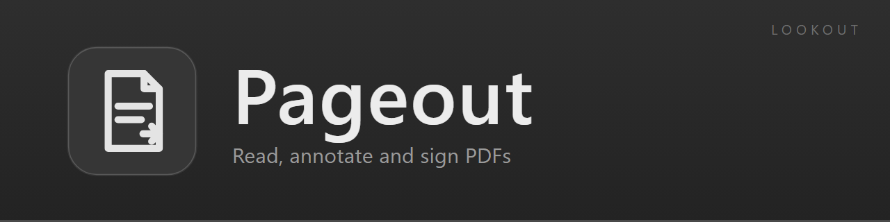
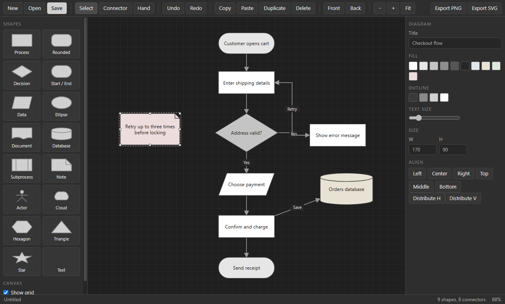
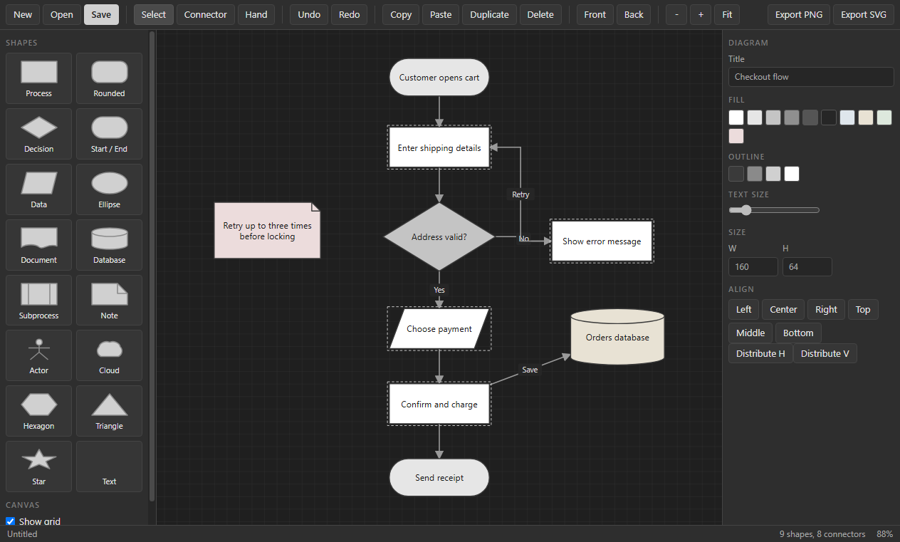
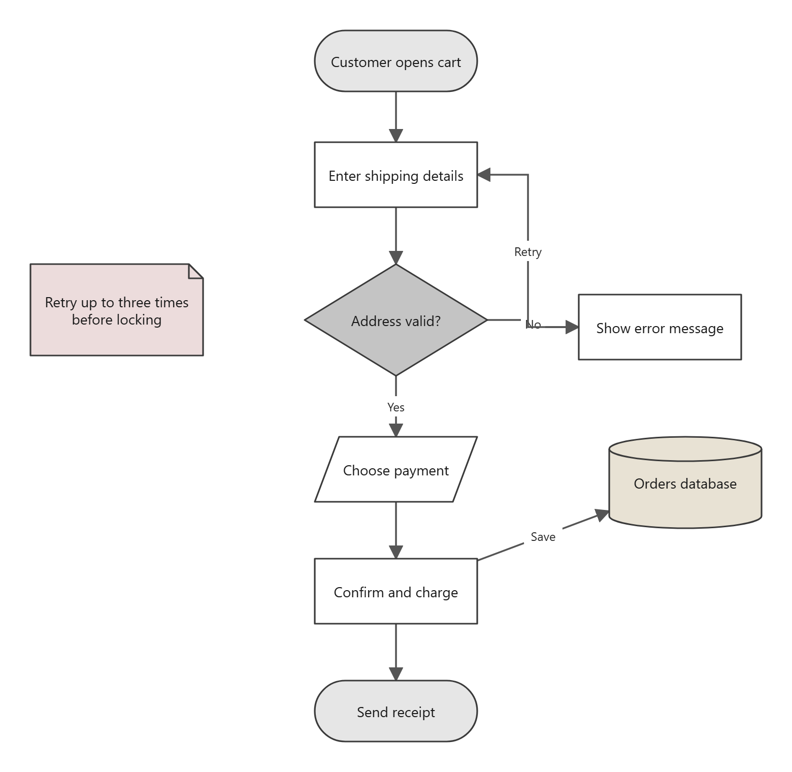
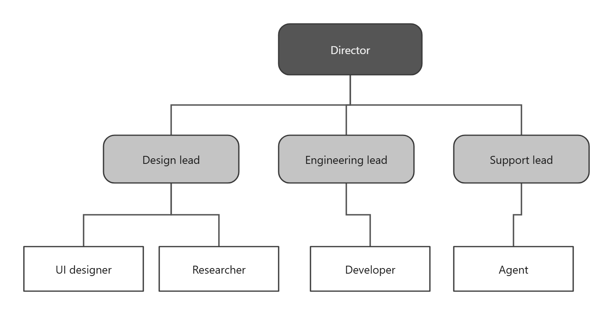

<b>Flowcharts and diagrams</b> Version 1.0.1 for Windows · Free · Offline · No account

<a href="https://github.com/plawanpawin-byte/chartout/releases/latest"><b>Download Chartout</b></a> · <a href="https://github.com/plawanpawin-byte/Lookout">All Lookout apps</a>

---

Chartout is a diagram maker for flowcharts, org charts, process maps and quick sketches of how things connect. Drag shapes onto an unlimited canvas, join them with connectors that follow the shapes around, then export a clean PNG or SVG.

**Made for:** Anyone explaining a process or a structure: teams documenting workflows, students drawing algorithms, managers mapping reporting lines.

## See it in action

### A flowchart on the canvas

Shapes on an unlimited canvas with labelled connectors. The decision diamond branches into Yes and No, and a retry arrow loops back.

### Shape properties

Select a shape to change its fill, outline, text and size in the panel on the right.

### Select, align and distribute

Select several shapes and tidy them with the align and distribute buttons so rows and columns line up exactly.

### Exported PNG

The same chart exported as a high-resolution image with a clean white background.

### Another result: an org chart

Elbow connectors route neatly from parent to child, which makes organisation charts quick to build.

## Everything it can do

### Shapes

- Process, rounded, decision, data, ellipse, document, database, subprocess, note, actor, cloud, hexagon, triangle, star and free text
- Change fill colour, outline, text and size in the properties panel
- Bring a shape to the front or send it back

### Connectors

- Connect any two shapes; the line follows when you move them
- Straight or elbow (right-angle) routing
- Optional arrowheads, dashed lines and text labels on every connector

### Arranging

- Select several shapes with a drag box or Shift + click
- Align and distribute horizontally or vertically
- Copy, paste and duplicate

### Canvas

- Unlimited canvas with pan, zoom and Fit
- Hand tool, or hold Space and drag to pan
- Undo and redo

### Files and export

- Save and reopen your diagrams as .chartout files
- Export PNG for documents and slides
- Export SVG for sharp scaling and further editing

## How to use it

1. Pick a shape from the left to place it on the canvas.
2. Double-click a shape and type its text.
3. Choose **Connector**, then click one shape and another to join them. Use **Edit label** to name a branch such as Yes or No.
4. Select several shapes and use the align and distribute buttons to straighten them.
5. Press **Export PNG** or **Export SVG**.

## Keyboard shortcuts

| Keys | What it does |
| --- | --- |
| Double-click | Edit a shape's text |
| Space + drag | Pan the canvas |
| Ctrl + mouse wheel | Zoom |
| Ctrl + A / C / V / D | Select all, copy, paste, duplicate |
| Ctrl + S | Save |
| Ctrl + Z / Y | Undo / redo |
| Delete | Remove the selection |

## Files and formats

Saves .chartout files. Exports PNG and SVG.

## Private by design

- No account, no sign-in, no subscription, no ads.
- Chartout works offline. It never sends your files, your text or anything about how you use it anywhere.
- Files are opened and saved only through the Windows file dialogs you use. Chartout cannot browse your disk on its own.
- The app window runs in a locked-down sandbox with a strict content policy.

## Install

1. Open the [latest release](https://github.com/plawanpawin-byte/chartout/releases/latest) and download the file named **Chartout-Setup-** followed by the version number and **.exe**. You can also install it from the [Lookout launcher](https://github.com/${OWNER}/lookout-launcher), which keeps it up to date.
2. Run the installer. It installs just for you, so it does not ask for administrator rights.
3. Windows may show a blue **Windows protected your PC** screen because these installers are not signed with a paid certificate. Click **More info**, then **Run anyway**.
4. Open Chartout from the Start menu.

**Requirements:** Windows 10 or 11, 64-bit. About 500 MB of free disk space. No internet connection is needed to use the app.

## Questions

**Can I open Visio or draw.io files?**  
Not yet. Export your old diagrams as images and redraw the parts you need.

**Is there a limit on diagram size?**  
No fixed limit. Use Fit to see a large diagram at once.

## About Lookout

Chartout belongs to the **[Lookout](https://github.com/plawanpawin-byte/Lookout)** family: ten small, private Windows apps for documents and media, all with the same calm grey look and the same promise that your files stay yours. Install and update them together with the [Lookout launcher](https://github.com/plawanpawin-byte/lookout-launcher).

Released under the MIT License.
