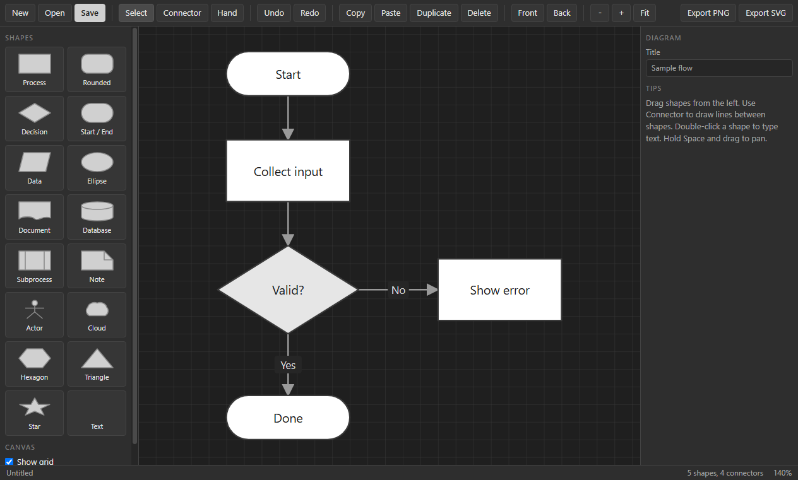

# Chartout

A clean, private diagramming app for Windows. Draw flowcharts, process maps and simple diagrams with no account, no subscription and no internet connection.

## What you can do

- **16 shapes**: process, decision, start/end, data, database, document, cloud, actor, hexagon, star and more
- **Connectors** that stay attached to shapes, with straight or elbow lines, arrows, dashes and labels
- **Edit freely**: drag, resize, multi-select, copy, paste, duplicate, bring to front, send to back
- **Align and distribute** selected shapes
- **Snap to grid** and an optional grid
- Pan and zoom, fit to window, undo and redo
- **Export** as PNG or SVG with a white background, or save as a Chartout file to continue later

## Your files stay on your computer

Chartout has no account, no cloud and no tracking. Files are opened and saved only through the dialogs you use, and nothing is uploaded.

## Download

Get **Chartout-Setup-1.0.0.exe** from the [Releases](../../releases/latest) page and run it.

Part of the [Lookout](https://github.com/plawanpawin-byte/Lookout) family of apps.

Released under the MIT License.
